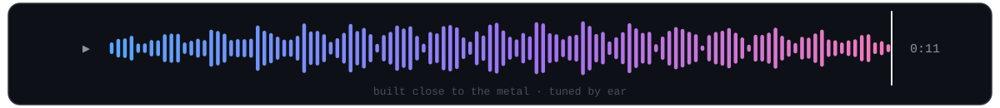

  

### `~$ cat about.md`

Hi, I'm Tommi 👋 Software engineering student at **42**, based in Nice.

I like working close to the machine: memory, system calls, and what code actually does on the CPU. I'm especially drawn to **embedded systems** and **music / audio tech**, where low-level code meets sound.

> [!NOTE]
> Looking for a work-study position (alternance/internship)** in embedded or systems software

### `~$ ls ~/stack`

### `~$ ./featured_project`

### `~$ ping me`

&nbsp;

